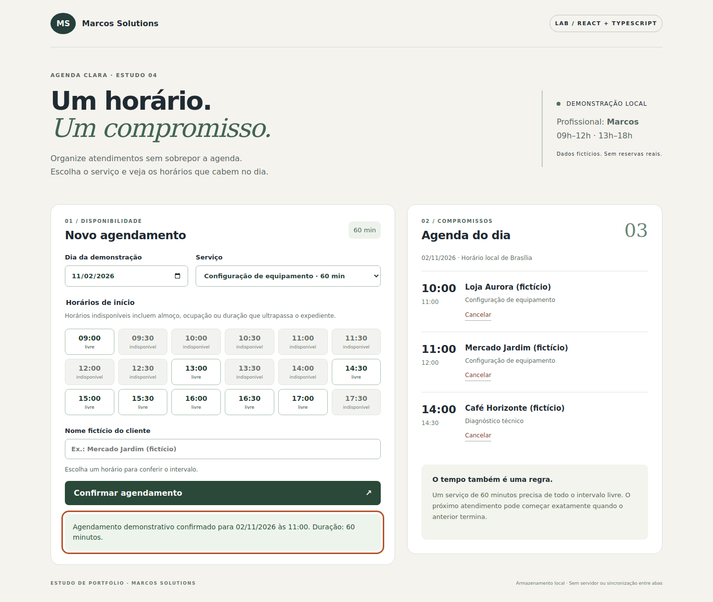

# Agenda Clara

A React + TypeScript portfolio lab by Marcos Solutions: schedule a service only when its entire duration fits an available interval.

**Fictional data. Local demonstration. Not a production booking system.**



## Problem
A small service business can accidentally accept overlapping appointments if it checks only the start time. Agenda Clara checks the whole interval, including lunch and the end of the workday.

## Run
Tested with Node.js 24.22.1 and npm 11.9.0.

```bash
npm ci
npm run dev
```
Open http://127.0.0.1:5173. Choose a service, a free start time and a fictional customer name. Confirm, refresh the page, then cancel the appointment.

```bash
npm run build
npm test
npx playwright install chromium
npm run test:e2e
```
On Linux, use `npx playwright install --with-deps chromium` if browser system packages are missing. The lockfile pins the tested dependency set; no claim of using the newest versions is made.

## Features
- One professional (Marcos), 30- and 60-minute services.
- Start times every 30 minutes; working windows 09:00–12:00 and 13:00–18:00.
- Full interval validation; adjacent appointments are allowed.
- Changing the service or day clears the selected start time.
- Confirmation, cancellation, availability refresh and local persistence.
- Invalid saved data falls back to the fictional initial schedule with a visible warning.
- Failed storage writes show a session-only warning.
- Native labelled controls, visible keyboard focus, pressed state for the selected time, focused error and confirmation messages.

## Decisions
The pure functions in `src/schedule.ts` implement the business rules independently of React. Intervals are half-open: `[start, end)`. They overlap when `startA < endB && startB < endA`; an appointment may start at the exact end of another.

Dates remain calendar strings and times are integer minutes on a fixed Brasília wall-clock schedule. No browser timezone conversion is performed. The demo permits every calendar day, including weekends and past dates, deliberately making it repeatable with the initial date 2026-11-02. Production booking horizons, holidays and daylight-saving/timezone rules are out of scope.

The UI derives available slots from bookings rather than storing a second availability list. The submission path rechecks the same business rule before committing a booking. Types describe expected data; `parseSaved` validates untrusted stored JSON, including duplicate identities and overlaps.

`src/storage.ts` isolates localStorage reads/writes and handles failures. Storage is convenient for a single-browser demo but provides **no cross-tab synchronization, shared server, multiuser locking or durable booking guarantee**. Two open tabs may overwrite one another. A production API must enforce conflicts atomically on the server; client checks alone cannot do that.

## Structure
- `src/schedule.ts`: availability, interval rules, runtime parsing.
- `src/storage.ts`: browser storage boundary.
- `src/main.tsx`: booking form and agenda presentation.
- `tests/schedule.test.ts`: business-rule tests.
- `tests/browser/booking.spec.ts`: browser flow tests.
- `docs/VALIDATION.md`: executed results and remaining checks.
- `docs/LINKEDIN.md`: Portuguese draft, not automatically published.
- `docs/ROTEIRO-5-DIAS.md`: study and interview plan.
- `media/`: real desktop/mobile screenshots and video.

## Limits
No authentication, real customer records, payments, notifications, backend or real reservations. Cancellation is immediate within the demonstration. Storage may be cleared by the browser and should not contain private customer information.

Accessibility features are implemented, but automated tests do not establish WCAG conformance. Screen-reader testing, manual zoom review, additional browsers and physical devices remain pending. The optional GitHub Actions workflow is supplied but has not been run on GitHub.

## Reference
[MDN: Using the Web Storage API](https://developer.mozilla.org/en-US/docs/Web/API/Web_Storage_API/Using_the_Web_Storage_API).

[Watch the short recorded demonstration](media/demo.mp4)
